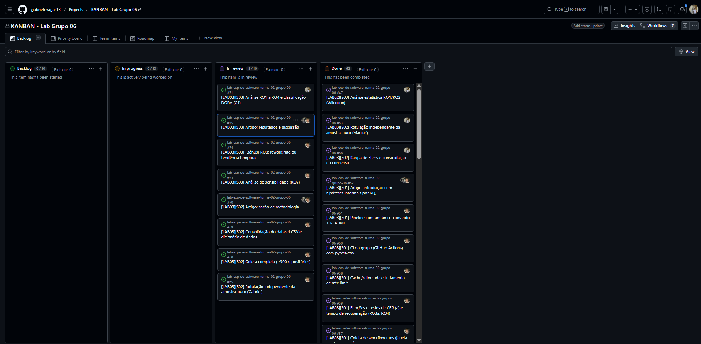
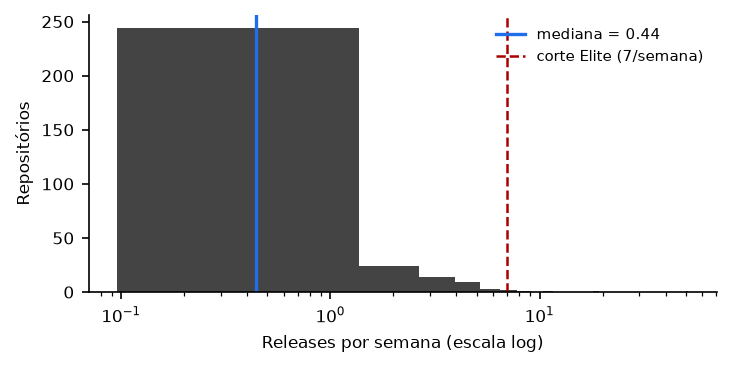
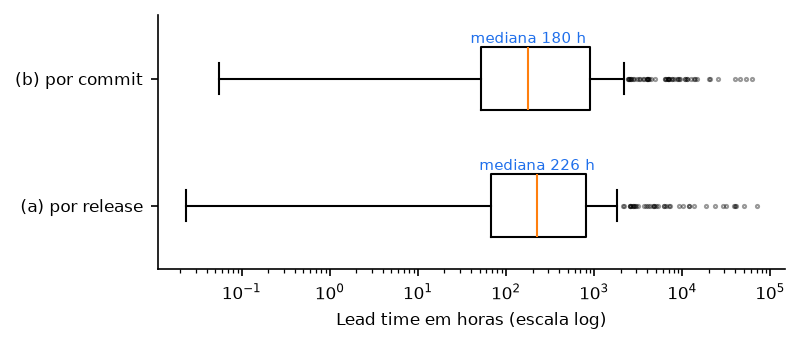
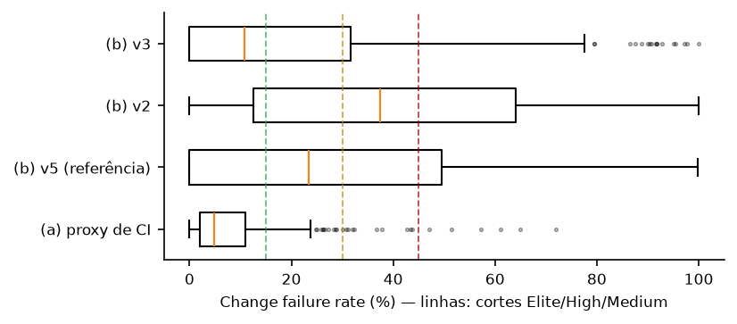
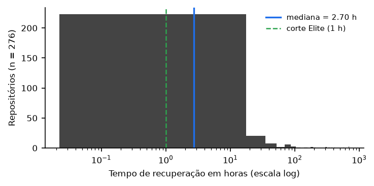
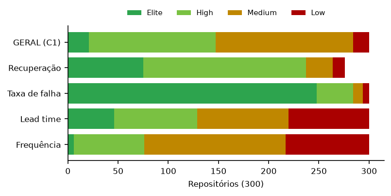
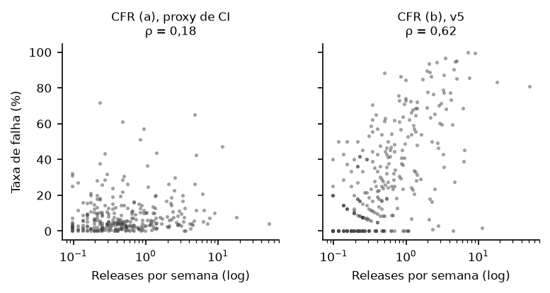
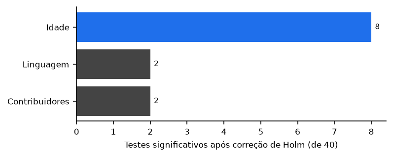
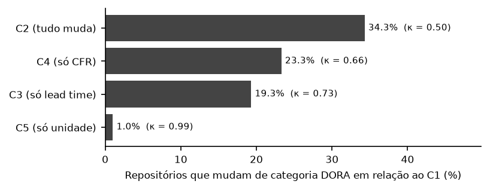
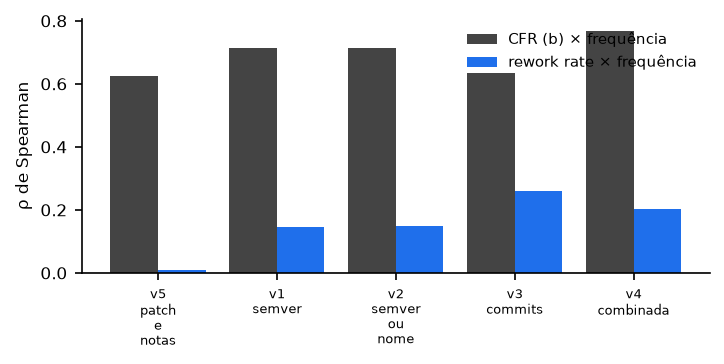

# Relatório de Laboratório

| | |
|---|---|
| **Curso** | Engenharia de Software |
| **Disciplina** | Laboratório de Experimentação de Software |
| **Turno / Período** | Noite / 6º |
| **Professor(a)** | Danilo Maia |
| **Laboratório** | Lab03 — Mineração de Métricas DORA |
| **Grupo (trio)** | Gabriel Chagas · Guilherme Lana · Marcus Vinicius |
| **Link do repositório / GitHub Projects** | https://github.com/gabrielchagas13/lab-exp-de-software-turma-02-grupo-06 · [board](https://github.com/gabrielchagas13/lab-exp-de-software-turma-02-grupo-06/projects) |
| **Data de entrega** | 21/10/2026 |

---

## 1. Introdução

As métricas DORA (*DevOps Research and Assessment*) tornaram-se o padrão de mercado para medir desempenho de entrega de software. São quatro: frequência de deploy, tempo entre o commit e a produção (*lead time*), proporção de deploys que causam falha (*change failure rate*, CFR) e tempo de recuperação. As duas primeiras medem velocidade; as duas últimas, estabilidade.

O problema é que **o GitHub não registra deploys em produção nem falhas em produção**. Um projeto open source publica *releases*, executa *workflows* de CI e recebe commits — e é disso que as métricas precisam ser inferidas. Uma medida indireta assim é um **proxy**: "release publicada" faz as vezes de deploy, "execução de CI que falhou" faz as vezes de falha. Proxies podem enganar, e quando enganam a conclusão muda junto. Por isso este trabalho faz duas perguntas, não uma: qual é o valor de cada métrica em repositórios populares, e **quanto se pode confiar nesse valor**.

### Questões de pesquisa

| RQ | Pergunta |
|---|---|
| RQ01 | Qual a frequência de deploys dos repositórios populares que usam CI/CD? |
| RQ02 | Qual o tempo entre um commit e seu respectivo deploy? |
| RQ03 | Qual a taxa de falha das mudanças entregues? |
| RQ04 | Qual o tempo de recuperação após uma execução de CI/CD com falha? |
| RQ05 | Repositórios com maior frequência de deploy apresentam maior ou menor taxa de falha? |
| RQ06 | Quais características dos repositórios estão associadas a um melhor desempenho DORA? |
| RQ07 | O quanto a classificação DORA depende da definição operacional escolhida? |
| RQ08 (bônus) | Como a *rework rate* se compara ao CFR (b)? |

### Hipóteses informais

O que o grupo espera encontrar em cada questão, derivado do referencial DORA e das definições operacionais adotadas. A versão completa, com a justificativa de cada uma, está em [`docs/hipoteses.md`](hipoteses.md).

| RQ | Hipótese |
|---|---|
| RQ01 | Mediana bem abaixo do corte Elite, entre uma release por mês e uma por semana — publicar release é evento de empacotamento, não de deploy contínuo. |
| RQ02 | A variante (a) deve ser sistematicamente maior que a (b), porque usa o commit mais antigo da release, que é um máximo sensível a um único commit esquecido. |
| RQ03 | O proxy de CI deve dar valores baixos e o de entrega, valores bem maiores; as duas variantes devem discordar. O sinal de *patch* sozinho deve ter recall alto e precisão baixa, exigindo combinação de sinais para atingir F1 ≥ 0,70. |
| RQ04 | Medianas na casa de horas e pouca censura, porque CI quebrado no branch principal bloqueia todo mundo. |
| RQ05 | Não esperamos o *trade-off* clássico, mas também não leremos correlação positiva como evidência a favor do DORA: o CFR (b) exige uma release seguinte em até 7 dias, e quem publica mais tem mais chance de tê-la. |
| RQ06 | Efeitos pequenos e poucos sobreviventes à correção de Holm; tipo de projeto e contribuidores acima de popularidade, porque estrelas medem visibilidade e não prática de engenharia. |
| RQ07 | Parcela substancial dos repositórios deve mudar de categoria, com o CFR movendo mais que o lead time. |
| RQ08 | A *rework rate* deve ser maior que o CFR (b) e correlacionar menos com a frequência de releases. |

### Inovações propostas pelo grupo (resumo)

Detalhamento na seção 3.6.

1. **Coleta de commits por clone local** em vez do endpoint `compare`, eliminando ~75% das chamadas à API e o teto silencioso de 10.000 commits.
2. **Dados brutos versionados em Parquet**, com reconstrução verificada, tornando a replicação comparável contra os dados originais.
3. **Refinamento iterativo da heurística corretiva até a meta de F1**, com validação em dados retidos e intervalo de confiança por *bootstrap*.
4. **Kappa de Cohen por par de avaliadores** além do Fleiss exigido, para localizar a origem da divergência.
5. **Teste do artefato mecânico da RQ05**, comparando a correlação do CFR (b) com a da *rework rate*.

---

## 2. Contexto

### Contexto acadêmico

Este é o **Lab03**, terceiro dos cinco laboratórios da disciplina. Ele se apoia na infraestrutura de mineração da API do GitHub construída no **Lab01** (busca paginada, tratamento de *rate limit*, cache em disco) e será a base do artigo atualizado no **Lab04**. Diferentemente do Lab02, que foi um experimento controlado com os próprios integrantes como sujeitos, aqui o objeto é externo: repositórios públicos reais.

### Objeto de estudo

A amostra é de **300 repositórios open source populares do GitHub que usam GitHub Actions**, observados numa janela de 12 meses (**01/10/2025 a 30/09/2026**). O critério de popularidade é estrelas (mínimo de 1.000), e o de atividade é ter ao menos 5 releases publicadas e 50 *workflow runs* válidos na janela.

### Base teórica

- **Métricas DORA e as faixas de desempenho:** Forsgren, Humble & Kim, *Accelerate* (2018), e o guia oficial do DORA.
- **Versionamento semântico** como sinal de release corretiva: especificação SemVer 2.0.0.
- **Interpretação de concordância entre avaliadores:** escala de Landis & Koch (1977).
- **Tamanho de efeito em dados ordinais:** Romano et al. (2006), para o δ de Cliff.
- **Censura em estatística**, para episódios de falha e releases que não podem ser avaliadas.

---

## 3. Metodologia

### 3.1 Principais Desafios

**O limite de requisições da API, e o limite que ninguém documenta.** O GitHub impõe dois limites distintos: o primário (5.000 requisições/hora) e o **secundário**, que dispara por rajada mesmo com cota primária sobrando e responde 403 sem `Retry-After`. A primeira versão do cliente tratava só o primário e morria no secundário. Foi preciso separar as cotas por recurso (`/search` tem cota própria de 30/min) e adicionar um limitador de ritmo global.

**Respostas truncadas em coletas grandes.** Páginas de *workflow runs* chegam a 3,8 MB. Com requisições concorrentes, parte delas vinha cortada, levantando `http.client.IncompleteRead` — exceção que **não** herda de `OSError` e, por isso, escapava do bloco de *retry*. Uma falha de transporte derrubava horas de coleta.

**Consumo de memória na coleta de runs.** O objeto cru de um *workflow run* tem ~8 KB de JSON; reduzido aos 7 campos usados, ~220 bytes. Acumular o objeto cru até o fim do repositório fez o processo chegar a **16 GB de RAM** e entrar em *swap*.

**O teto silencioso do `compare`.** O endpoint `compare/{base}...{head}` **trunca em 10.000 commits sem avisar**. Em repositórios que mantêm várias linhas de versão em paralelo (`v14`, `v15`, `v16` no `frappe/erpnext`), a comparação entre releases consecutivas por data cruza ramos e varre a divergência inteira. Dos 18.910 pares do dataset, **57 passam do teto**, em 5 repositórios — com o maior chegando a 33.418 commits. O lead time (a) dessas releases estava errado.

**Ambiguidade da definição de "release corretiva".** Não há campo na API que a marque. A concordância entre os três avaliadores na amostra-ouro ficou em **kappa de Fleiss 0,324** (razoável), o que é em si um achado: o critério é ambíguo antes de ser automatizado.

**Corrupção de dados por editor de planilha.** O Google Sheets reinterpretou 33 tags da planilha de rótulos como números (`22.1.0` virou `22.1.2000`), o que fazia a heurística ler *patch* = 2000. As tags foram realinhadas pela URL de cada release, preservando todos os rótulos.

### 3.2 Tomadas de Decisão

| Decisão | Alternativas | Por que esta |
|---|---|---|
| **Commits via clone local** (`git log base..head`) em vez do `compare` | manter o `compare` da API | 75% menos chamadas, ~300x mais rápido no pior repositório, e **sem o teto de 10.000**. Equivalência verificada: 120/120 pares idênticos em 5 repositórios, e nos 50 divergentes do `erpnext` o conjunto da API estava contido no do git |
| **CFR (b) de referência = v5** (*patch* **e** release notes citando correção) | v1 a v4 | única com **F1 ≥ 0,70** (0,723) contra o consenso. O enunciado manda refinar até a meta. As demais ficam como sensibilidade |
| **Não rerrotular a amostra-ouro** | refazer os rótulos divergentes | rerrotular depois de ver a heurística e os colegas quebraria a independência que dá sentido ao kappa. A divergência vira achado, não erro corrigido |
| **Mediana e IQR**, nunca média e desvio | média | distribuições muito assimétricas: o maior lead time é 70.293 h contra mediana de 226 h |
| **Censurar, não descartar** | excluir casos sem desfecho | descartar faria os repositórios parecerem mais rápidos para se recuperar do que são. 869 releases e os episódios sem recuperação ficam registrados |
| **Pré-releases fora da definição principal** | incluí-las | o enunciado define deploy como release publicada não-rascunho; pré-release entra só como variante C2/C5 na RQ07 |
| **Paralelismo de 3 threads com limitador global** | coleta serial; mais threads | serial usava só 20% da cota (16 de 83 req/min), perdendo tempo em latência. O limitador reserva slots globalmente, então o teto de 80 req/min não muda com o número de threads |
| **Limite de WIP = 10 por coluna** | sem limite; limite menor (3 a 5) | o trio trabalha em frentes paralelas (coleta, validação manual e análise), e cada sprint abre ~8 issues simultâneas. Um limite de 3 a 5 travaria o board sem refletir impedimento real. Com 10, a coluna *In review* chegou a 8/10 no pico da S03 — perto do teto, mas sem bloquear |

### 3.3 Etapas

| Sprint | Entregas | Responsável | Issues |
|---|---|---|---|
| **S01** | Seleção, funil e metadados | Gabriel Chagas | #53, #61 |
| | Releases, tags, commits entre releases e lead time | Guilherme Lana | #54, #55, #56 |
| | Workflow runs, cache/rate limit, CFR (a) e recuperação | Marcus Vinicius / Gabriel | #57, #58, #59, #60 |
| **S02** | Rotulação independente da amostra-ouro (3 integrantes) | os três | #63, #64, #65 |
| | Kappa de Fleiss e consolidação do consenso | Marcus Vinicius | #66 |
| | Heurística corretiva (CFR b) e refinamento até a v5 | Guilherme Lana | #67 |
| | Coleta completa (300), dataset e dicionário de dados | Marcus / Gabriel | #68, #71 |
| **S03** | RQ01–RQ04 e classificação DORA C1 | Marcus Vinicius | #71 |
| | RQ05 e RQ06 | Guilherme Lana | #72 |
| | RQ07 (sensibilidade) e RQ08 (bônus) | Gabriel Chagas | #73, #74 |
| | Relatório e artigo | os três | #70, #75 |

Os números acima foram conferidos contra o board. A rotulação da amostra-ouro foi feita pelos três integrantes em issues separadas (#63 Marcus, #64 Guilherme, #65 Gabriel), como o enunciado exige.

#### Configuração do processo

- **Board:** GitHub Projects (v2), o mesmo usado desde o Lab01.
- **Colunas:** Backlog → To Do → Doing → Review → Done.
- **Limite de WIP:** 10 itens por coluna (ver justificativa em 3.2).
- **Print do board ao final do laboratório:**

No momento da captura: 62 itens em *Done*, 8 em *In review* (limite 10) e nenhum em *Backlog* ou *In progress* — o trabalho da S03 estava todo entregue e aguardando revisão.

Todo commit referencia o número da issue correspondente, que é o que liga o board ao código na correção.

### 3.4 Ferramentas

| Finalidade | Ferramenta |
|---|---|
| Coleta | **API REST do GitHub**, por cliente próprio (`pipeline/http.py`), sem bibliotecas de terceiros para consulta à API |
| Commits entre releases | **git** (clone `--bare --filter=tree:0` + `git log`) |
| Linguagem | **Python 3.12** |
| Manipulação de dados | **pandas 3.0**, **pyarrow 26** (Parquet) |
| Estatística | **SciPy 1.17** (Spearman, Kruskal-Wallis, Mann-Whitney), **statsmodels** (Holm, kappa de Fleiss), **scikit-learn** (kappa de Cohen, precisão/recall/F1) |
| Visualização | **Matplotlib** |
| Testes | **pytest** + **pytest-cov** (347 testes, 85% de cobertura), executados no **GitHub Actions** do próprio grupo a cada push |
| Processo | **GitHub Projects (v2)** |

### 3.5 Tabela de Métricas

| RQ | Métrica | Definição operacional | Unidade | Ferramenta / Fonte |
|---|---|---|---|---|
| RQ01 | Deployment frequency | Releases publicadas na janela ÷ semanas da janela (≈ 52,1) | releases/semana | `/repos/{r}/releases` |
| RQ02 | Lead time (a), por release | Mediana, entre as releases, de (`published_at` − `author_date` do commit mais antigo que ela entrega) | horas | clone local (`git log`) |
| RQ02 | Lead time (b), por commit | Mediana, sobre todos os commits novos de todas as releases, de (`published_at` − `author_date`) | horas | clone local (`git log`) |
| RQ03 | CFR (a), proxy de CI | Runs com falha ÷ (falhas + sucessos), no default branch com `event=push`. Falha = `failure`, `timed_out`, `startup_failure`; `cancelled`/`skipped`/`neutral`/`action_required`/`stale` e vazio são ignorados | proporção 0–1 | `/repos/{r}/actions/runs` |
| RQ03 | CFR (b), proxy de entrega | Releases seguidas, em até 7 dias, por uma release corretiva ÷ releases avaliadas. Corretiva (v5) = *patch* semver > 0 **e** release notes citando `fix`/`bugfix`/`hotfix`/`revert`. Releases dos últimos 7 dias da janela ficam fora do denominador (censura) | proporção 0–1 | `/repos/{r}/releases` + heurística |
| RQ04 | Tempo de recuperação | Mediana dos episódios: (`updated_at` do sucesso seguinte − `run_started_at` da primeira falha), **dentro de cada workflow**. Episódios sem desfecho na janela são censurados | horas | `/repos/{r}/actions/runs` |
| RQ05 | Correlação | ρ de Spearman entre RQ01 e cada variante da RQ03 | ρ, p, n | `scipy.stats.spearmanr` |
| RQ06 | Associação por fator | Kruskal-Wallis entre quartis (estrelas, contribuidores, idade) e linguagem, com correção de Holm e ε² = H/(n−1) | p, ε² | `scipy` + `statsmodels` |
| RQ07 | Sensibilidade | % de repositórios que mudam de categoria DORA entre combinações, e kappa de Cohen ponderado linear com IC 95% por bootstrap | %, κ | `sklearn.metrics` |
| RQ08 | Rework rate | Releases que **são** corretivas ÷ total de releases avaliadas | proporção 0–1 | heurística corretiva |
| — | Classificação DORA | 4 pontos (Elite) a 1 (Low) por métrica, pelos cortes fixos da disciplina; categoria geral = mediana das quatro notas arredondada **para baixo** | categoria | `metricas/dora.py` |

### 3.6 Inovações Propostas pelo Grupo (30% da nota)

#### (c) Arquitetura de coleta: commits por clone local

**O que foi feito.** O cálculo do lead time deixou de usar o endpoint `compare` e passou a usar um clone `--bare --filter=tree:0` (só objetos de commit) com `git log base..head`.

**Por que é relevante.** Dois ganhos, e o segundo é de correção, não de desempenho:

1. **Volume.** As chamadas ao `compare` eram ~75% de todo o tráfego (≈22.000 de 29.276 na coleta de 100 repositórios). O `frappe/erpnext` sozinho custava ~5.600 chamadas e 1h23; pelo clone leva **17 segundos e 42 MB**.
2. **Correção.** O `compare` **trunca em 10.000 commits sem avisar**. Validando contra os dados já coletados do `erpnext`: 134 dos 184 pares bateram exatamente, e **os 50 divergentes tinham API = exatamente 10.000**, com o conjunto da API contido no do git. Para essas releases, o "commit mais antigo" da variante (a) estava errado.

**Onde o resultado aparece.** Seções 3.1 e 4.1; o lead time de todas as RQ02, RQ05, RQ06 e RQ07 depende disso.

#### (c) Dados brutos versionados em Parquet, com reconstrução verificada

**O que foi feito.** Os JSON da coleta (1,45 GB) são exportados para 10 tabelas Parquet normalizadas (**164 MB**, maior arquivo 51,5 MB) e versionados no repositório. Um importador faz o caminho inverso e regrava os JSON.

**Por que é relevante.** O enunciado prevê que o grupo replicador compare os resultados dele com o CSV final e que "pequenas diferenças são esperadas porque os repositórios continuam recebendo commits". Com o dado bruto versionado, essa variável **desaparece**: o replicador pode rodar o pipeline sobre os dados originais e atribuir qualquer divergência ao código, não à data da coleta.

A fidelidade foi verificada nos **902 arquivos reais**: exportar, reimportar e comparar campo a campo deu **902 idênticos, 0 diferentes**. O teste de ida e volta detectou dois defeitos antes da entrega: repositório sem nenhuma release e release sem commits novos — este último um dos casos de borda que o próprio enunciado manda testar — sumiam na reconstrução.

**Onde o resultado aparece.** Seção 3.4 e na seção de replicação do artigo.

#### (d) Refinamento da heurística até a meta, com validação em dados retidos

**O que foi feito.** As quatro combinações iniciais (v1 a v4) ficaram entre F1 0,54 e 0,68, abaixo da meta de 0,70. O grupo criou a **v5**, que exige *patch* semver **e** release notes citando correção, e atingiu **F1 = 0,723**. Além do F1 simples, foram calculados o F1 em **dados retidos** (33 releases que não participaram da escolha: 0,65) e o **IC de 95% por bootstrap** entre repositórios (0,63 a 0,80).

**Por que é relevante.** O enunciado pede o F1 e o refinamento, mas não o controle de *overfitting*. Escolher a variante olhando a mesma amostra em que ela é medida infla o resultado; reportar o valor retido e o IC é o que impede que 0,723 seja lido como precisão real.

**Onde o resultado aparece.** Seção 4.3 e na tabela de validação.

#### (d) Kappa de Cohen por par, para localizar a divergência

**O que foi feito.** Além do kappa de Fleiss exigido (que dá um número único para os três), calculou-se o **kappa de Cohen entre cada par**.

**Por que é relevante.** O Fleiss de 0,324 diz "concordância razoável", mas não diz *onde* está o problema. Os pares mostram que a divergência **não é difusa**: entre dois avaliadores o kappa é **0,86** (quase perfeita), e do terceiro contra cada um deles é **0,19** e **0,18**. Isso muda o diagnóstico — não é um critério universalmente ambíguo, é uma leitura divergente de um avaliador, que contou como corretiva toda release que *contém* correções em vez de só aquelas cujo objetivo principal é corrigir.

Como teste de robustez, o F1 da v5 foi recalculado contra os **281 itens em que ao menos dois avaliadores concordam**: **0,737**, praticamente igual ao do consenso completo — o que mostra que a conclusão não depende do avaliador divergente.

**Onde o resultado aparece.** Seção 4.3 e nas ameaças à validade.

#### (d) Teste do artefato mecânico da RQ05

**O que foi feito.** A RQ05 encontra correlação positiva entre frequência de deploy e taxa de falha, o que contraria o DORA. Em vez de aceitar o resultado, o grupo testou a hipótese de que ele é **artefato da definição**: o CFR (b) exige uma release seguinte em até 7 dias, e quem publica mais tem mais chance de tê-la. O teste compara a correlação do CFR (b) com a da **rework rate**, que mede a mesma coisa **sem** a janela de 7 dias.

**Por que é relevante.** É a diferença entre reportar "velocidade e estabilidade não andam juntas" e reportar "a definição que usamos produz essa correlação sozinha".

**Onde o resultado aparece.** Seção 4.3 (RQ05 e RQ08) e na Conclusão. O resultado é decisivo: **ρ = 0,625** para o CFR (b) contra **ρ = 0,008** para a rework rate.

---

## 4. Resultados

### 4.1 Coleta de Dados

**Funil de seleção.** Dos candidatos obtidos por busca fatiada por faixas de estrelas:

| Etapa | Restantes | Descartados |
|---|---|---|
| Candidatos (busca por faixas de estrelas) | 4.511 | — |
| Forks ou arquivados | 4.407 | 104 |
| Sem push na janela | 4.092 | 315 |
| Sem GitHub Actions | 3.985 | 107 |
| Menos de 5 releases na janela | 3.559 | 426 |
| Menos de 50 runs válidos na janela | 3.492 | 67 |
| **Amostra final** (sorteio com semente 42) | **300** | 3.192 não avaliados |

**Volume analisado:** 300 repositórios, **2.115.292 workflow runs**, **18.964 releases** e **911.421 commits distintos**, em 24 linguagens, na janela de 01/10/2025 a 30/09/2026.

**Dados ausentes e censura, e como foram tratados:**

- **24 repositórios (8%) sem nenhum episódio de falha** não têm tempo de recuperação. Entram na classificação DORA com **três** métricas em vez de quatro — atribuir-lhes um valor arbitrário empurraria a mediana sem respaldo no dado.
- **869 releases (4,6% das 18.964)** publicadas nos últimos 7 dias da janela ficaram fora do denominador do CFR (b), porque ainda não se sabe se haverá correção.
- **Episódios de falha sem recuperação** dentro da janela foram censurados e reportados como proporção, não descartados.
- **Outliers mantidos.** O maior lead time é de 70.293 h contra mediana de 226 h. Nenhum valor extremo foi removido; o uso de mediana e IQR em todas as tabelas é a forma de lidar com eles sem descartar dado real.

### 4.2 Visualização Gráfica

Todas as figuras desta seção são geradas por `python -m scripts.gerar_figuras_relatorio`. Onde a distribuição varia por ordens de grandeza (frequência, lead time, recuperação) o eixo está em **escala logarítmica**; sem isso a mediana fica colada na origem e só os extremos aparecem. A medida de tendência central reportada é sempre a **mediana**.

**RQ01 — Qual a frequência de deploys?**

*Figura 1 — Distribuição de releases por semana (escala log). A linha azul é a mediana (0,44); a vermelha, o corte Elite de 7 por semana.*

| Métrica | Mediana | IQR |
|---|---|---|
| Releases por semana | **0,44** | 0,23 – 1,04 |

Uma release a cada 2,3 semanas. Só **6 repositórios (2%)** chegam ao corte Elite de 7 por semana, e 83 (28%) ficam em Low.

**RQ02 — Qual o tempo entre commit e deploy?**

*Figura 2 — Lead time nas duas variantes obrigatórias (escala log). A variante (a) é deslocada à direita por usar o commit mais antigo de cada release.*

| Variante | Mediana | IQR |
|---|---|---|
| (a) por release | **226,3 h** (9,4 dias) | 68,1 – 818,0 h |
| (b) por commit | **179,8 h** (7,5 dias) | 52,4 – 900,9 h |

Em **98 repositórios (33%)** a variante (a) é mais que o dobro da (b).

**RQ03 — Qual a taxa de falha?**

*Figura 3 — CFR por variante, com os cortes Elite (15%), High (30%) e Medium (45%). O proxy de CI concentra-se bem abaixo do corte Elite; o de entrega espalha-se por todas as faixas.*

| Variante | Mediana | IQR |
|---|---|---|
| (a) proxy de CI | **4,9%** | 2,1 – 10,9% |
| (b) proxy de entrega, **v5 (referência)** | **23,5%** | 0,0 – 49,4% |
| (b) v2 semver ou nome | 37,5% | 12,5 – 64,1% |
| (b) v3 commits | 10,8% | 0,0 – 31,6% |

**RQ04 — Qual o tempo de recuperação?**

*Figura 4 — Tempo de recuperação (escala log), nos 276 repositórios com ao menos um episódio de falha.*

| Métrica | Mediana | IQR | n |
|---|---|---|---|
| Tempo de recuperação | **2,70 h** | 0,95 – 9,69 h | 276 |

**Classificação DORA de referência (C1):**

*Figura 5 — Distribuição das categorias DORA por dimensão e no geral. A amostra é forte em estabilidade (taxa de falha e recuperação) e fraca em velocidade (frequência e lead time).*

| Dimensão | Elite | High | Medium | Low | % Elite+High |
|---|---|---|---|---|---|
| Frequência de deploy | 6 | 70 | 141 | 83 | 25,3% |
| Lead time | 46 | 83 | 91 | 80 | 43,0% |
| Change failure rate | 248 | 36 | 10 | 6 | **94,7%** |
| Tempo de recuperação | 75 | 162 | 27 | 12 | 85,9% |
| **Geral** | **21** | **126** | **137** | **16** | **49,0%** |

**RQ05 — Frequência × taxa de falha (ρ de Spearman, n = 300):**

*Figura 6 — Frequência de deploy contra taxa de falha, nos dois proxies (eixo x em log). A relação é fraca no proxy de CI e clara no de entrega.*

| CFR | ρ | p |
|---|---|---|
| (a) proxy de CI | 0,178 | 0,002 |
| (b) **v5 (referência)** | **0,625** | < 0,001 |
| (b) v4 combinada | 0,768 | < 0,001 |

*Figura 7 — Testes que sobrevivem à correção de Holm, por fator. A idade (em destaque) responde por 8 dos 12; estrelas não aparecem.*

**RQ06 — 12 de 40 testes significativos após Holm.** A idade é o fator dominante (8 dos 12), seguida de contribuidores (2) e linguagem (2). Estrelas não mostram efeito algum.

**RQ07 — Sensibilidade (categoria geral):**

*Figura 8 — Proporção de repositórios que mudam de categoria DORA em relação ao C1, com o kappa ponderado de cada par. Trocar só o CFR move mais que trocar só o lead time; trocar a unidade de deploy quase não move.*

| Par | % que mudou | Kappa linear | IC 95% |
|---|---|---|---|
| C1 × C2 (tudo muda) | **34,3** | 0,496 | 0,414 – 0,574 |
| C1 × C3 (só lead time) | 19,3 | 0,732 | 0,669 – 0,800 |
| C1 × C4 (só CFR) | 23,3 | 0,660 | 0,591 – 0,726 |
| C1 × C5 (só unidade de deploy) | 1,0 | 0,986 | 0,971 – 1,000 |

Por métrica, o CFR muda **62,0%** dos repositórios de categoria, com kappa **0,008** — sem concordância além do acaso.

**RQ08 — Rework rate (v5):**

*Figura 9 — Correlação de cada métrica com a frequência de releases, por variante da heurística. O CFR (b) acompanha a frequência; a rework rate, que mede o mesmo sem a janela de 7 dias, não acompanha — evidência do artefato mecânico discutido na RQ05.*
 mediana de **43,2%** contra 23,5% do CFR (b); maior em 58,7% dos repositórios.

### 4.3 Discussão

#### Hipótese por hipótese

| RQ | Hipótese | Resultado | Veredito |
|---|---|---|---|
| RQ01 | mediana entre mensal e semanal | 0,44/semana | **confirmada** |
| RQ02 | (a) > (b) sistematicamente | 226 h vs 180 h; 33% com (a) > 2×(b) | **confirmada** |
| RQ03 | CI baixo, entrega alto, discordância | 4,9% vs 23,5% | **confirmada** |
| RQ03 | *patch* sozinho: recall alto, precisão baixa | recall 0,90, precisão 0,55 | **confirmada** |
| RQ04 | horas, pouca censura | 2,70 h, censura ~0 | **confirmada** |
| RQ05 | sem *trade-off*, com suspeita de artefato | ρ 0,178 (a) vs 0,625 (b) | **confirmada** |
| RQ06 | tipo de projeto e contribuidores dominam | **idade** domina (8 de 12) | **refutada** |
| RQ07 | parcela substancial muda; CFR pesa mais | 34,3%; CFR 62% vs lead time 43,3% | **confirmada** |
| RQ08 | rework > CFR (b), menos correlacionada | 43,2% vs 23,5%; ρ 0,008 vs 0,625 | **confirmada** |

**A hipótese que falhou foi a da RQ06**, e a falha é informativa. O grupo apostou em tipo de projeto e contribuidores; quem dominou foi a **idade**. Acertamos só a parte negativa, que estrelas não explicariam nada. A leitura mais provável é que idade seja **fator de confusão** e não causa: projetos antigos acumulam branches e commits antigos, o que alonga o lead time (a) por construção, já que ele usa o commit mais antigo da release.

#### Os proxies discordam, e isso muda a conclusão

O CFR é a métrica em que a definição mais pesa. O mesmo repositório é **Elite pelo CI e High ou Medium pela entrega**, e 94,7% da amostra aparece como Elite+High em estabilidade — número que vem justamente do proxy mais otimista. Resultados em categorias DORA só fazem sentido acompanhados da definição usada.

#### Velocidade e estabilidade: o que a inovação (d) acrescentou

Os dados **não confirmam** que velocidade e estabilidade andam juntas: a frequência correlaciona **positivamente** com a taxa de falha. Mas o teste do artefato mecânico mostra que boa parte disso é efeito da definição. O CFR (b) e a rework rate medem a mesma coisa e diferem apenas pela exigência da janela de 7 dias; mesmo assim, a correlação com frequência é **ρ = 0,625** para o primeiro e **ρ = 0,008** para o segundo.

Ou seja: a correlação observada vem em boa parte de quem publica mais ter mais chance de ter uma release seguinte dentro do prazo, e não de entregar com mais defeitos. **Sem essa inovação, o trabalho teria reportado uma contradição ao DORA que os dados não sustentam.**

#### Ameaças à validade

**Construto.** Release publicada não é deploy, e CI vermelho não é falha em produção — o segundo proxy subestima a instabilidade sistematicamente. A `author_date` é distorcida por *rebase* e *squash merge*. A heurística corretiva tem erro relevante mesmo na v5 (F1 0,723, e 0,65 em dados retidos). Tags não foram usadas como unidade de deploy na definição principal.

**Interna.** A idade se associa a várias métricas e provavelmente confunde os demais fatores. O tipo do projeto, rotulado na amostra-ouro, não entrou como fator na RQ06.

**Externa.** A amostra tem projetos populares, com GitHub Actions e releases regulares; não representa projetos privados nem os que entregam sem releases do GitHub. Janela de 12 meses.

**Conclusão (estatística).** Foram 40 testes na RQ06, corrigidos por Holm, e alguns grupos de linguagem têm poucos repositórios. A amostra-ouro tem 300 releases de 60 repositórios, e o kappa em duas dimensões é apenas razoável. A **v5 foi escolhida olhando a própria amostra**, o que torna seu F1 otimista.

**Processo.** A rotulação divergente de um avaliador (Cohen 0,19 e 0,18 contra 0,86 entre os outros dois) não foi corrigida por rerrotulagem, por decisão metodológica. O teste de robustez contra os 281 itens com ao menos dois concordantes (F1 0,737) mostra que as conclusões não dependem dessa divergência.

---

## 5. Conclusão

As quatro métricas DORA foram medidas em 300 repositórios populares, e a resposta mais importante não é o valor de nenhuma delas: é que **o valor depende mais da definição operacional do que se poderia esperar**. A taxa de falha varia por um fator de cinco entre os dois proxies, e um terço dos repositórios muda de categoria DORA quando as definições mudam — quase inteiramente por causa do CFR.

O perfil da amostra é de projetos **estáveis e lentos**: muito bem nas duas dimensões de estabilidade, mal nas duas de velocidade. Mas a nota alta em estabilidade vem do proxy de CI, que é o mais otimista; trocá-lo pelo proxy de entrega rebaixa a dimensão e move 62% dos repositórios.

A frequência de deploy **não** se associa a menos falhas, o que contrariaria o DORA — mas o teste do artefato mecânico mostra que a correlação é em boa parte efeito da janela de 7 dias da própria definição. A idade do repositório é o fator mais associado ao desempenho, e provavelmente é fator de confusão.

**Limitações principais:** a heurística de release corretiva tem erro relevante mesmo na melhor versão, e foi escolhida na própria amostra; a amostra-ouro é pequena e teve concordância apenas razoável em duas dimensões; a amostra externa é restrita a projetos populares com Actions.

**O que faríamos diferente com mais tempo:** definir o critério de "release corretiva" com um protocolo escrito e exemplos antes de rotular — o kappa de 0,32 mostra que o critério foi para campo ambíguo demais; incluir tags como unidade de deploy; e usar o tipo de projeto, que já está rotulado, como quinto fator da RQ06.

**Inovações que valeriam expandir:** o teste do artefato mecânico (inovação *d*) é generalizável — qualquer métrica DORA definida por janela temporal pode ser testada assim contra uma versão sem janela. E a verificação de ida e volta dos dados brutos (inovação *c*) é o que permitiria uma replicação cruzada sem a variável "a coleta foi em outra data".

---

## 6. Referências

- FORSGREN, N.; HUMBLE, J.; KIM, G. *Accelerate: The Science of Lean Software and DevOps*. IT Revolution, 2018.
- DORA. *DORA's software delivery metrics: the four keys*. Disponível em: https://dora.dev/guides/dora-metrics-four-keys/
- DORA. *A history of DORA's software delivery metrics*. Disponível em: https://dora.dev/insights/dora-metrics-history/
- LANDIS, J. R.; KOCH, G. G. The measurement of observer agreement for categorical data. *Biometrics*, v. 33, n. 1, p. 159–174, 1977.
- ROMANO, J. et al. *Appropriate statistics for ordinal level data*. Annual Meeting of the Florida Association of Institutional Research, 2006.
- WOHLIN, C. et al. *Experimentation in Software Engineering*. Springer, 2012.
- PRESTON-WERNER, T. *Semantic Versioning 2.0.0*. Disponível em: https://semver.org/lang/pt-BR/
- ZUSE, H. *A framework of software measurement*. Walter de Gruyter, 2013.
